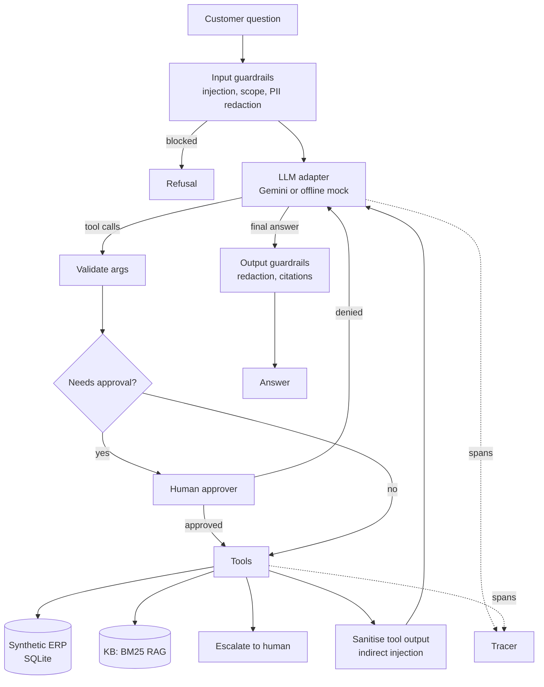

# Agentic ERP Support Copilot

A support agent for ERP customers, built to show the parts of an agentic system that matter in production: **tool use, retrieval (RAG), human-in-the-loop approval, guardrails, evaluations and tracing**. It runs locally, uses only synthetic data, and **needs no API key** (a deterministic offline model stands in for Gemini, so tests and evals run in CI).

```text
$ erp-copilot ask "Why is INV-1003 on hold and how do I get it released?"

Invoice INV-1003 is on hold: 9,200.00 USD, due 2026-10-15. Reason: PO number mismatch.
For a PO mismatch, ask the buyer to confirm the correct PO number and update it on the
invoice header. ... [source: invoice-holds#how-to-release-a-hold]

tools: get_invoice_status, search_kb
```

More captured runs (traces, approval flow, injection blocked, escalation): [`docs/demo.txt`](docs/demo.txt).

## What it does

| Capability | How it is implemented |
|---|---|
| Agent loop with tool use | Model returns tool calls, loop validates and runs them, feeds results back, stops on a final answer or a step limit (then escalates). `src/erp_copilot/agent.py` |
| Tools | Invoice, order and ticket lookup, knowledge-base search, credit-memo request, escalate to human. JSON-schema specs, argument validation, hallucinated tools rejected. `tools.py` |
| RAG | Markdown corpus chunked by section, BM25 ranking with a coverage check so off-topic questions get "no answer" instead of a wrong one. Answers cite `doc#section`. `rag.py` |
| Human in the loop | Write tools are approval-gated. Denied means nothing happens. Credit memos above 1,000 USD are flagged for a manager. The agent escalates on request, on anger or legal wording, and on knowledge-base misses. |
| Guardrails | Prompt-injection screening on input, **indirect injection neutralised in tool output** (a planted ticket note tries to trigger a refund), PII redaction (cards, emails, SSNs) before the model and in traces, scope check, per-customer tenant isolation. `guardrails.py` |
| Evals | 21 behaviour cases (tool use, RAG, HITL, guardrails) plus retrieval recall@3 and MRR. Checks behaviour, not exact wording, so it also works with a real model. The CLI exits non-zero below the gate. `evals.py`, `evals/` |
| Tracing | Nested spans (`agent.run`, `llm.generate`, `tool.call`, `human.approval`, `guardrail.*`) with timings. Print with `--trace`, export JSONL with `--trace-file`. `tracing.py` |

## Architecture



## Run it

```bash
python -m venv .venv && source .venv/bin/activate
pip install -e ".[dev]"

erp-copilot ask "Where is order ORD-2001?" --trace
erp-copilot ask "Please issue a credit of \$500 on INV-1002"     # prompts for approval
erp-copilot chat --customer C-1002
erp-copilot eval                                                # behaviour + retrieval evals
pytest -q
```

Sample customers: `C-1001`, `C-1002`, `C-1003`. Sample records: `INV-1001..1006`, `ORD-2001..2005`, `TCK-3001..3004`.

### Using Gemini

```bash
export GEMINI_API_KEY=...        # optional: GEMINI_MODEL=gemini-2.5-flash (default)
erp-copilot ask "Why is INV-1003 on hold?" --provider gemini
erp-copilot eval --provider gemini
```

`--provider auto` (default for `ask` and `chat`) uses Gemini when the key is set and the offline mock otherwise. The Gemini adapter is a small standard-library REST client (`llm/gemini.py`) for `generateContent` with function calling.

## Results (offline mock model)

```
cases: 21/21 passed (pass rate 1.0)
  guardrails 6/6 | human-in-the-loop 6/6 | rag 4/4 | tool-use 5/5
retrieval: recall@3=1.0 mrr=1.0 (18 questions)
pytest: 27 passed, ruff and mypy clean
```

CI (`.github/workflows/ci.yml`) runs lint, type checks, tests and the eval gate on Python 3.10 and 3.12.

## Honest scope notes

- **The offline model is a rule-based planner, not a language model.** It exists so the whole system is testable and deterministic. These 100% eval scores prove the harness, tools, guardrails and approval flow work. They say nothing about Gemini's language quality.
- **Live Gemini run (gemini-2.5-flash, Oct 2026): 17-18 of 21 eval cases passed across two runs (0.81-0.86), retrieval recall@3 1.0 (retrieval does not use the model).** Output is not deterministic, so the count varies by run and the CLI gate (`--min-pass 1.0`) fails on the live model. Offline, the deterministic mock still scores 21/21 and the 27 tests pass. Cases that failed live: the model sometimes skips the invoice lookup before a credit request or an escalation (tool-order drift), sometimes refuses an oversized credit in text without calling the approval tool, and phrases the "suspicious tool text removed" notice in words the check does not match. The system prompt and the eval wording checks (which now accept several phrasings) got one tuning round; the remaining failures are left as known issues, not hidden. Safety behaviour held in these runs: credit memos always went through the approval gate and the injection and PII cases passed.
- **The KB corpus is small and synthetic (10 documents).** The retrieval score and the no-answer thresholds (`KB_MIN_SCORE`, `KB_MIN_COVERAGE` in `tools.py`) are tuned on it. The margin between answerable and unanswerable questions is thin, and a larger corpus needs re-tuning or an embedding or reranking stage.
- Guardrails are regex and heuristics. They are a demonstration of where the checks sit, not a complete defence.
- Data is fictional (Acme Industrial, Globex Retail, Umbra Foods). Nothing here connects to a real ERP, and no vendor system is emulated.
- Approval is a callback. The CLI asks on the terminal. A real deployment would route it to a review queue.
- `erp-copilot eval` reads cases from the repo `evals/` folder, so run it from a checkout.

## Layout

```
src/erp_copilot/   agent, tools, rag, guardrails, tracing, llm/{mock,gemini}, evals, cli
src/erp_copilot/data/kb/   synthetic ERP documentation
evals/             behaviour cases and retrieval questions
tests/             unit tests and eval gate
```

## License

MIT, see [LICENSE](LICENSE).
